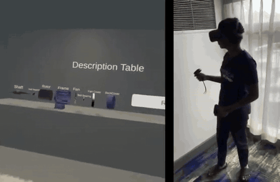

# VR Electric Generator Teardown Lab

A virtual reality lab where engineering students learn how an electric generator is built. Wearing a headset, students walk around a virtual lab, pick up and inspect the generator's parts with their hands, and study a labelled exploded view of the whole machine.

Built in Unity with C# for Oculus headsets (tested on Oculus Quest with Touch controllers), as part of an Extended Reality (XR) engineering workshop for undergraduate students.



**Demo video:** https://www.youtube.com/watch?v=BrQKqbDHWYc · **One-page summary:** [Project Summary (PDF)](Docs/Project%20Summary.pdf)

## What you can do

The lab has two stations:

- **Interactive Table.** The generator's parts lie on the table. Reach out, grab any part with your virtual hand, turn it over and look at it from any angle.
- **Description Table.** The generator is shown as a labelled exploded view: shaft, ball bearings, rotor, frame, fan, fan cover and back cover. Expand it to see how the parts line up, then press **Return** to put it back together.

You can also:

- **Move around the lab** by walking (room-scale) or by pointing a controller at the floor and teleporting.
- **See your hands.** Your controllers show as animated hands, or as models of the controller you are holding.

## How it works

| Script | What it does |
|---|---|
| `LocomotiveController.cs` | Shows the teleport ray while the chosen controller button is held, and hides it while you are pointing at something you can interact with, so the teleport and interaction rays never clash. Works for both hands. |
| `HandPresence.cs` | Finds the connected controller, spawns the matching controller model (or a default one), and switches between hand and controller views. |
| `Expand.cs` | Plays the generator's expand and return animations when the user presses the table controls. |
| `TransformScript.cs` | Slides each part out along the X axis to its own stop position, building the exploded view frame by frame. |

Grabbing, pointing and teleporting use Unity's XR Interaction Toolkit.

## Built with

- Unity 2019.4.9f1
- C#
- XR Interaction Toolkit 0.9.4 (preview) and XR Management
- Oculus XR Plugin and Oculus Integration (hand models)
- Windows Mixed Reality XR Plugin
- TextMesh Pro, Shader Graph and Timeline

## Running the project

1. Install **Unity 2019.4.9f1** (Unity Hub makes this easy).
2. Clone the repository and open the `XR Project` folder in Unity.
3. Open the scene `Assets/Scenes/VR Game.unity`.
4. Connect an Oculus headset (Quest with Oculus Link, or Rift) or a Windows Mixed Reality headset.
5. Press **Play**.

### Controls

- **Grab:** reach a hand to a part and hold the grip button.
- **Teleport:** hold the teleport button, point at the floor, then release.
- **Exploded view:** use the controls on the Description Table; press **Return** to reassemble.

## Project structure

```
XR Project/
├── Assets/
│   ├── Scenes/VR Game.unity      Main VR lab scene
│   ├── LocomotiveController.cs   Teleport locomotion
│   ├── HandPresence.cs           Hand and controller models
│   ├── Expand.cs                 Exploded-view animation control
│   ├── TransformScript.cs        Part separation
│   ├── VR Rig.prefab             Player rig (headset and controllers)
│   └── electric motor.fbx        Generator model
├── Packages/
└── ProjectSettings/
```

## Author

Uzoma Peters, [github.com/JoshuaPeters-hub](https://github.com/JoshuaPeters-hub)
